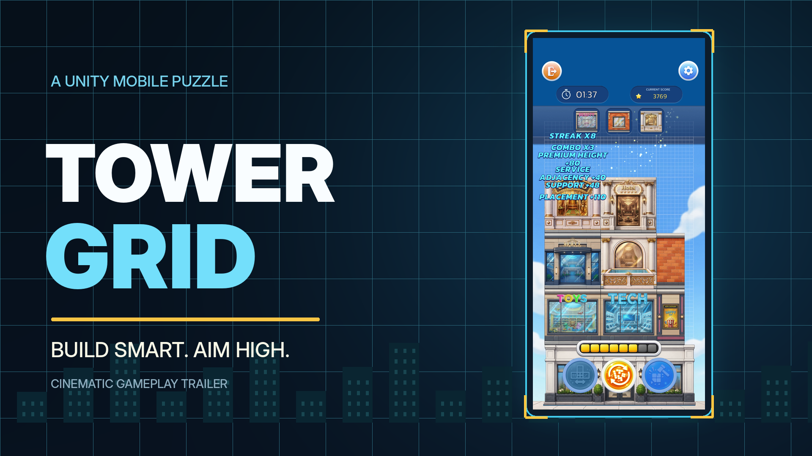
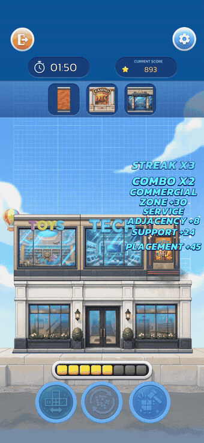
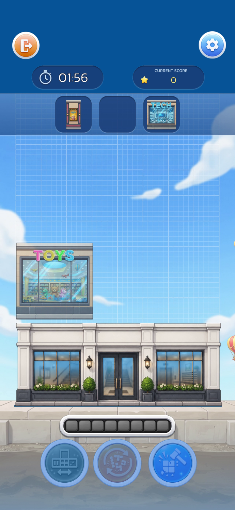
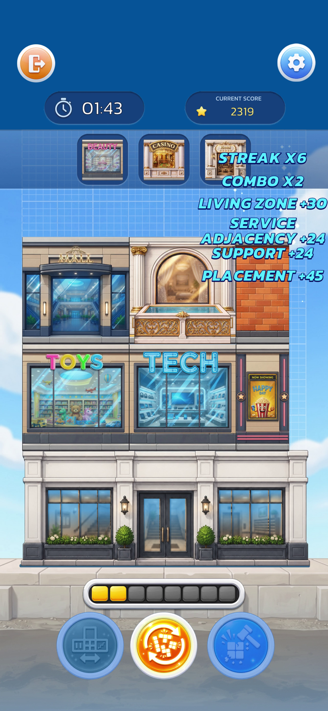
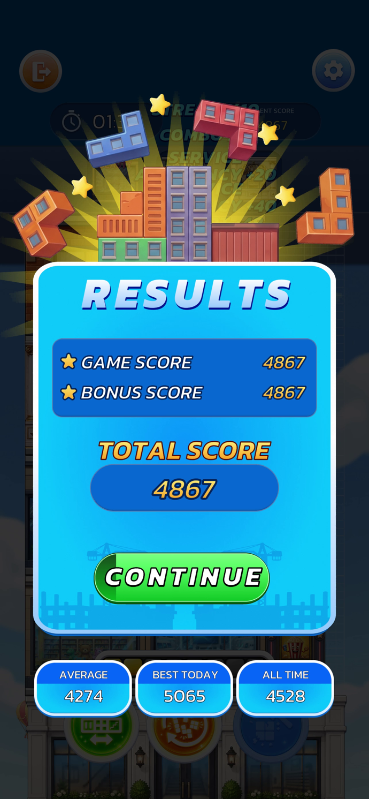

# TowerGrid

**A grid-based mobile puzzle game built with Unity and C#**

*Build a tower. Plan every placement. Chain bonuses to push your score higher.*

**[Watch the trailer](docs/media/TowerGrid_Trailer.mp4)** · **[Explore the architecture](docs/ARCHITECTURE.md)** · **[View gameplay](#gameplay-preview)**

Click the cover to open the 33-second gameplay trailer.

## Overview

TowerGrid is a mobile building-puzzle game where players assemble a growing tower from different building pieces. Each placement affects the available space and can trigger score bonuses based on the current layout. Timed sessions, active skills, customization, and progression systems add variety to the core loop.

This repository is an **offline portfolio edition** of a commercially developed **team project**, presented to showcase its gameplay systems, Unity architecture, and interface implementation.

## Gameplay preview

  

- **Grid-based building** — Place pieces of different sizes while accounting for available space and support constraints.
- **Contextual scoring** — Earn points from placements, structural support, adjacency, floor completion, zoning, and combinations.
- **Active abilities** — Use demolition, draft refresh, and rezoning mechanics to influence a run.
- **Timed runs** — Progress through tutorial, countdown, active gameplay, and results states.
- **Meta systems** — Explore shop, customization, daily tasks, and battle-pass interfaces.

## Screenshots

<table>
  <tr>
    <td align="center" width="33%"></td>
    <td align="center" width="33%"></td>
    <td align="center" width="33%"></td>
  </tr>
  <tr>
    <td align="center"><strong>Building</strong></td>
    <td align="center"><strong>Combos & bonuses</strong></td>
    <td align="center"><strong>Results</strong></td>
  </tr>
</table>

## Engineering highlights

| Area | Implementation |
| --- | --- |
| **Architecture & DI** | VContainer lifetime scopes separate project-level services from gameplay scene dependencies. |
| **Core gameplay** | Grid occupancy and building placement checks are handled independently of the UI. |
| **Score calculation** | A dedicated calculator evaluates placement and contextual scoring bonuses. |
| **Game flow** | A state machine manages tutorial, countdown, playing, and game-over phases. |
| **Content** | ScriptableObject-based building catalogs and configurations support different building types and visual sets. |
| **UI & progression** | Popup/overlay services, shop screens, quests, cosmetic options, and battle-pass interfaces. |
| **Offline adaptation** | Local match results and score storage replace dependencies on tournament and company services. |

### Code worth exploring

- [`BuildingGrid.cs`](Assets/Game/Scripts/Gameplay/Building/Grid/BuildingGrid.cs) — occupancy, boundaries, placement, and support checks.
- [`BuildingScoreCalculator.cs`](Assets/Game/Scripts/Gameplay/Building/BuildingScoreCalculator.cs) — scoring rules and bonuses.
- [`GameplayStateMachine.cs`](Assets/Game/Scripts/Gameplay/Core/StateMachine/GameplayStateMachine.cs) — gameplay state transitions.
- [`ProjectLifetimeScope.cs`](Assets/Game/Scripts/GameRoot/ProjectLifetimeScope.cs) — project-level dependency registration.
- [`LocalScoreStorage.cs`](Assets/Game/Scripts/Gameplay/Core/Services/LocalScoreStorage.cs) — local score persistence for this portfolio edition.

For the scene flow and service boundaries, see the [Architecture Overview](docs/ARCHITECTURE.md).

## Tech stack

`Unity` · `C#` · `VContainer` · `UniTask` · `URP` · `Unity UI` · `ScriptableObjects`

## Running the project

1. Clone or download the repository and add its root folder in **Unity Hub**.
2. Open it using the **Unity Editor and render-pipeline combination you have verified locally**; wait for packages to resolve.
3. Open [`Assets/Game/Scenes/Boot.unity`](Assets/Game/Scenes/Boot.unity) and enter **Play Mode**.
4. A fresh local profile starts with the tutorial; returning profiles proceed to the main menu.

> **Editor compatibility:** The provided `ProjectVersion.txt` records **Unity 2022.3.62f3**, while the package manifest references **URP 17.0.4**. The editor/package combination should be checked before attempting a fresh import on another machine.

## Project background

This project was developed commercially by a team. I contributed as a Unity developer; the repository is presented as a portfolio reference, **not** as a claim of sole authorship of every system, script, or asset.

For the portfolio edition, integrations requiring company services, attribution, or a tournament backend were removed or replaced with local implementations so the core gameplay can be demonstrated independently.

**Asset and usage note:** Third-party plugins and art assets retain their respective licenses. This repository does not grant redistribution rights to those packages, and no open-source license is declared for the complete project.
