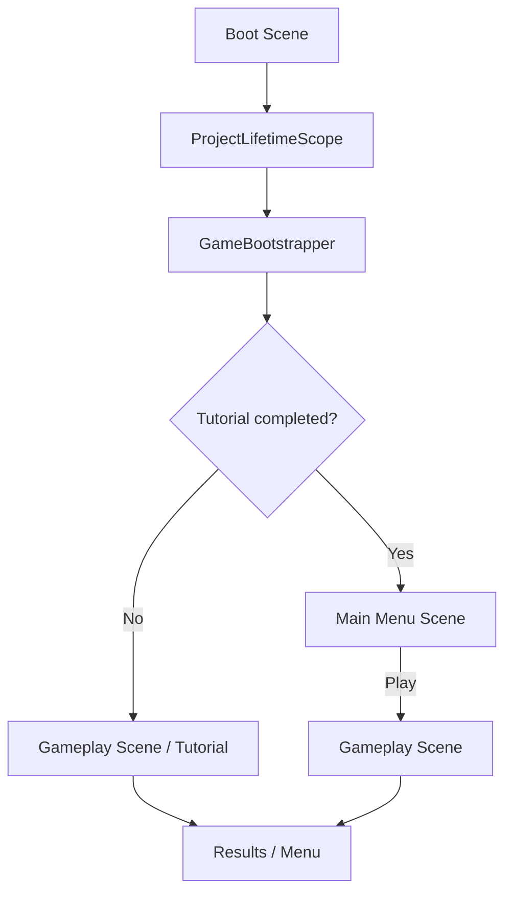

# Architecture Overview

Tower Grid uses Unity scenes for initialization, gameplay, and the main menu, with VContainer handling service lifetimes and injection.

## Initialization

- `GameRoot/ProjectLifetimeScope.cs` configures shared services, including popup and overlay management, scene navigation, data storage, score and progression services, and local analytics.
- `GameRoot/GameBootstrapper.cs` selects the initial experience. Fresh profiles are directed to tutorial gameplay; returning profiles navigate to the main menu.
- `GameRoot/Services/Scenes/SceneService.cs` coordinates scene changes.

## Gameplay modules

- **Grid and building placement** — `Gameplay/Building/Grid/BuildingGrid.cs` tracks occupied slots and validates placement, boundaries, and structural support.
- **Building content** — `Gameplay/Building/Data/BuildingCatalog.cs` stores building definitions in ScriptableObjects.
- **Score calculation** — `Gameplay/Building/BuildingScoreCalculator.cs` combines placement and contextual bonuses such as support, adjacency, floor completion, zoning, and combos.
- **Match lifecycle** — `Gameplay/Core/StateMachine/GameplayStateMachine.cs` switches between tutorial, countdown, playing, and game-over states.
- **Skills** — `Gameplay/Skills/` contains demolition, draft refresh, and rezoning systems.
- **UI** — scene binders and shared popup services keep most menu/gameplay interactions separate from core rules.

## Progression and persistence

Daily quests, shop logic, currency and battle pass systems live under `MainMenu/`. Global persistence services are registered in `ProjectLifetimeScope`. The portfolio edition stores score results locally through `LocalScoreStorage`.

## Offline integration boundary

- The original tournament SDK and corporate backend are not required to start or finish a local match.
- `OfflineAnalyticEventService` satisfies the existing analytics interface but sends no events to external services.
- Gameplay results and best-score views use device-local storage.

## Scope of the repository

This is a team-developed Unity application presented for engineering review. Its presence in this repository does not imply exclusive authorship of all included systems or artwork.
